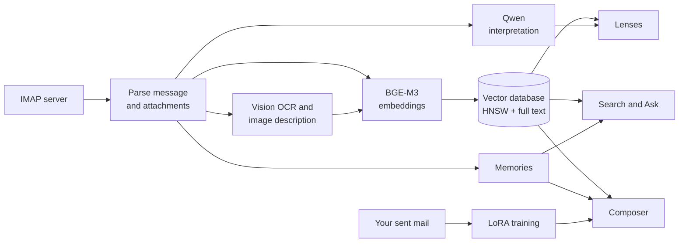

# Ohia

**Your correspondence, reorganized by meaning.**

Ohia is an experimental email client for macOS that runs open-weight language models entirely on your Mac. It reads your mail over IMAP, builds a semantic index of everything you have received and sent, interprets each message with a local model, learns your writing voice from your sent mail, and drafts replies grounded in the conversation. Messages are shown in a Metal-rendered spatial view where each one is a node placed by meaning.

Ohia is research software. Version 0.9.0 is the first public release, and the app will keep changing.

This README describes the current development version. A few things it describes arrive after 0.9.0, in the next release: signing in with Microsoft, the in-app reset, PDF parsing in a sandboxed service of its own, embedding documents sized to the model's token window, and word-aware passage selection for languages written without spaces.

## Why Ohia exists

Ohia is a working test of a question: how far can open-weight models running on consumer hardware go on tasks that usually depend on cloud AI services? It examines three of them, applied to a real mailbox of tens of thousands of messages:

- **Semantic search.** Finding mail by meaning across languages, beyond keyword matches.
- **Categorization.** Reading each message for what it asks of you: whether it needs a reply or a confirmation, its deadlines, topics, and a summary, each with a confidence score.
- **Context-rich generation.** Drafting replies that draw on the thread, related correspondence and attachments, written in the user's own voice through continuous fine-tuning on their sent mail.

Everything runs on the Mac, and no mail is sent to a cloud AI service. Ohia is also meant to show what that costs: which tasks small local models handle well, where they fall short, and how much memory, storage and time the work takes.

## Origins

Unix mail programs have been named for trees since Elm, and Ohia keeps the tradition. What it sets out to leave behind is the mailbox.

| Year | Program | |
| --- | --- | --- |
| 1979 | MH | The message-handling system written at RAND: one file per message, driven from the shell. |
| 1986 | Elm | "ELectronic Mail", an early full-screen mail client, and the first tree. |
| 1988 | Eudora | Named for the writer Eudora Welty. Its promise was to bring the post office to where you live. |
| 1989 | Pine | From the University of Washington. Its name was a recursive acronym, "Pine Is Not Elm", later given the formal expansion "Program for Internet News and E-mail". |
| 1995 | Mutt | Elm's interface rewritten from scratch, with message threading and scoring. |
| 2007 | Alpine | Pine carried forward after the University of Washington stopped developing it. |
| 2026 | Ohia | The ʻōhiʻa lehua: a field of nodes placed by meaning, with no mailbox in view. |

**The mailbox outlived every client that made it.** Across all of these, and across every graphical client since, one thing has not changed: an inbox, a sent folder, more folders, and the formats and protocols that serve them, from mbox files to IMAP. It is essentially the architecture MH was scripting in 1979.

**Why this tree.** The ʻōhiʻa lehua is endemic to the Hawaiian islands and is usually the first plant to grow on new lava. Its flower has hardly any petals to speak of: it is a burst of stamens, each tipped with a point of yellow. Once every message is a node, that is what a mailbox looks like. The flower is the app's emblem, and its leaf green and stamen yellow are the colours of the app's controls.

**What the letters stand for.** Like Pine, the name is a recursive acronym: *Ohia Hates Inbox Architecture*. And as Pine later took a formal expansion, so does Ohia: *Ontological Hypergraph of Intelligent Associations*, a graph of messages whose meaning lives in their associations.

**The step past the mailbox.** Eudora brought the post office to where you live. Ohia's proposal is that the post office was never the right shape for what email became. IMAP is treated as a source to read from, not a structure to reproduce: the mailbox stays intact on your server, and nothing in Ohia's interface is a folder.

## Design principles

- **Content first, interpretation as an overlay.** When you open a message, the message itself is the primary object. Ohia's reading of it (weighted dimensions, the evidence behind them, the neighbourhood of related messages) sits on top, on demand. Labels trace back to the passages that produced them, and when signals conflict, the conflict stays visible instead of being settled out of sight.
- **Identity as a distribution.** A correspondent is not "a coworker". Their role is a set of weights across roles, which shifts as the exchange changes and is shown as weights.
- **Uncertainty shows.** Low confidence, split interpretations and missing data appear as such, never as silence or false certainty. A message whose category is unclear is marked uncertain rather than forced into one.
- **Structure, not an agent.** Ohia shows signals, weights and patterns. It does not present itself as someone who decided something, and the interface avoids anthropomorphic language, with one exception: the background pass that distils Memories is called dreaming, and even there it shows its progress.
- **You remain the sender.** Drafts are assembled from your answers, the sources you chose and your own sent mail. Accuracy, tone, recipients, attachments and the decision to send stay with you.

## What it does

- **Mail over IMAP and SMTP.** Ohia downloads your mail over IMAP and keeps it in a local store. Reading and analysis never change your mailbox; Ohia writes to it only when you act: sending, saving drafts, filing, flagging or deleting. Outgoing mail goes through an outbox with retries.
- **Semantic index.** Every message, and the text and images in its attachments, is embedded with [BGE-M3](https://huggingface.co/BAAI/bge-m3), a multilingual embedding model, running under Core ML, and stored in a local vector database. Results are reranked with [bge-reranker-v2-m3](https://huggingface.co/BAAI/bge-reranker-v2-m3).
- **Interpretation.** A local [Qwen](https://huggingface.co/Qwen) model, run with [MLX](https://github.com/ml-explore/mlx-swift), classifies each message, decides whether it needs a reply or a confirmation, extracts deadlines and labels, and writes a summary.
- **Your writing voice.** Ohia continuously fine-tunes a LoRA adapter on your sent mail, so drafts take on your phrasing.
- **Memories.** Ohia keeps short, evidence-backed notes about your accounts, correspondents, kinds of mail, projects and translation preferences, distilled from your mail by the local model, and uses them when it drafts and answers questions.
- **Composer.** For a reply, Ohia gathers the relevant thread, past correspondence, attachments, memories and other context, asks you the questions it needs answered, and then drafts.
- **Five ways to see your mail.** The same mail can be read as a newspaper, a map of meanings, a solar system of correspondents, a timeline, or a set of projects and deadlines. See [Ways of looking at your mail](#ways-of-looking-at-your-mail).
- **Several models, each for one job.** A Qwen language model, BGE-M3 embeddings with a reranker, and Apple's on-device models for images, translation, language identification and dictation. See [The models](#the-models).
- **Other sources.** Attachments (PDFs, Office documents, spreadsheets and images) are parsed locally, and images are read with Apple's Vision framework. Calendar, Contacts, Reminders and Messages can be added as context with your permission. Where Apple Intelligence is available, some helper tasks, including describing images, use Apple's on-device models. External tools can be connected through the Model Context Protocol (MCP).

## Ways of looking at your mail

Ohia has no mailbox list. Instead, the same corpus can be viewed through five lenses, chosen from the Scope section at the right of the top bar or from View › Scope (⌘3 to ⌘7). The other sections of the top bar are filters that carry across lenses: Destination (which accounts), Moments (the time window), Voices (correspondents in From, To, Cc or Bcc), Action, Category and Status. Switching lens changes how the selected mail is arranged, not which mail is selected.

### Digest

A newspaper front page for your mail, and the lens Ohia opens in. A masthead shows the time window and counts of unread mail, mail that needs a reply or a confirmation, and deadlines. Below it come a lead story, a row of feature cards, and sections grouped by purpose (correspondence, receipts, newsletters, travel and so on) that recede down the page. Placement is by recency within a fixed budget of slots, so a busy week narrows the page to its newest mail. A thread with several messages collapses into a single card that expands in place. Opening a card turns the page into a reader: headline, byline and dateline, the model's summary as the lede, the original message, the replies in the thread newest first, and the attachments.

### Meanings

A three-dimensional map of your mail drawn with Metal, where distance means difference in meaning. Each message is a node positioned from its embedding (see [Layout and clusters](#layout-and-clusters)), so mail about the same subject gathers together whatever its sender or date. Groups of related mail are drawn as glowing clouds and labelled with a generated title and their most distinctive terms. A slider sets how many clusters are shown, clicking a cluster filters the scene to it, and clicking a node flies the camera to it and opens the message.

### Correspondents

Your correspondents as a solar system, with you as the sun. Each correspondent is a planet, and its orbit is drawn from your history together:

- **How close it comes** shows how recently you have been in touch.
- **The shape of the orbit** shows how reciprocal the relationship is. Balanced exchanges ride near-circular orbits, one-sided ones stretch out, and institutional senders you never answer travel long, dashed, comet-like arcs.
- **How fast it moves** shows how much the correspondent is waiting on from you, weighted by how long unanswered requests have been open.

Rings around each planet show the mail between you in four tiers: mail sent to you directly, mail you were copied on, mail you sent to them directly, and mail you sent with them copied. Clicking a planet brings it forward with its emails as satellites in its rings.

### Timeline

Your mail laid out like a video editor's timeline. A reader at the top follows the playhead. Below it are a time ruler with zoom controls, a minimap histogram with received mail rising above the midline and sent mail falling below it, and a multitrack view with rows for sender, receiver, attachments, category, thread and account. The arrow keys step message by message; with ⇧ they step by a day and with ⌥ by a week.

### Projects

You define a project as a rule (File › New Project, ⇧⌘N): which accounts, correspondents, languages, tags or keywords belong to it, and from what date. Ohia matches new mail against the rule as it arrives and suggests related tags as the project grows. Projects are shown as a Gantt chart: each bar is a burst of actual mail activity rather than a planned duration, received and sent messages sit above and below the bar, and dashed connectors bridge quiet periods. Double-clicking a project opens its workroom: a summary dossier, a feed of its emails newest first, a catalog of the files exchanged, and a generated guide to what the project needs next.

A second tab, **Deadlines**, lists every deadline Ohia has found, counting down the days until each is due, beside a month calendar. Deadlines are mirrored to a dedicated "Ohia" calendar in the Calendar app with alarms, and changes you make there (date, title or alarms) come back into Ohia.

### Alongside the lenses

- **Search and Ask** share a sidebar (⌘F). Search is an exact finder: it shows where and how often your terms occur (subject, body, attachments, sender), how the matches are distributed over time, clusters and senders, and the nearest messages by meaning, and it moves the scene to a chosen match. It deliberately does not show a list of results. Ask answers questions in plain language about the mail currently in view, with numbered citations that open the cited messages.
- **Composer** (⌘2) is a separate window for replies and new mail, with columns for the reply queue, the sources a draft draws on, and writing style.
- **Junk and Trash** (⌘J) opens a drawer that reads those folders live from the server. They are never ingested or analyzed.
- **Mailing lists** (Mail › Email Lists, ⌥⌘L) lists every subscription Ohia has seen, with its volume, cadence and how much of it you read, and offers one-click unsubscribe.
- **Translation** shows a translation beside the original in the readers, using the local Qwen model or Apple's Translation framework.

## The models

Ohia combines several models, each chosen for one kind of work. Two are downloaded from Hugging Face during setup: a Qwen language model, and BGE-M3 with its reranker for retrieval. The rest are part of macOS. No model call leaves your Mac, except that dictation can use Apple's speech service (see [Your data](#your-data)).

| Model | What it does in Ohia | Runs with |
| --- | --- | --- |
| [Qwen3.5 or Qwen3.8](#generative-model-qwen), 0.8B to 27B parameters | Reads and classifies mail, writes summaries and answers, prepares and writes replies, translates, distils Memories | MLX, on the GPU |
| [Your LoRA adapter](#lora-fine-tuning) | Gives drafts your phrasing | MLX, on top of the Qwen model |
| [BGE-M3](#embedding-model-bge-m3) | Turns text into vectors for search, the spatial layout and clustering | Core ML: CPU, GPU and Neural Engine |
| [bge-reranker-v2-m3](#reranker-bge-reranker-v2-m3) | Rescores search candidates by reading query and passage together | Core ML |
| [Apple Translation](#translation) | Optional translation engine | macOS, on device |
| [Apple Foundation Models](#apple-intelligence) | Describes images, summarizes attachments, stands in when Qwen cannot answer | Apple Intelligence, on device |
| [Apple Vision](#apple-vision-naturallanguage-and-speech) | Reads text in images and detects what an image contains | macOS, on device |
| [Apple NaturalLanguage](#apple-vision-naturallanguage-and-speech) | Identifies languages and finds sentence and word boundaries | macOS, on device |
| [Apple Speech](#apple-vision-naturallanguage-and-speech) | Dictation in Ask | macOS |

### Generative model: Qwen

One Qwen model does all of Ohia's language work. Setup measures your Mac's unified memory and offers two choices: **Performance**, the default, which is lighter and faster, and **Quality**, the largest model that fits. You can switch later in Settings › Models.

| Unified memory | Performance (default) | Quality |
| --- | --- | --- |
| 8 to 15 GB | Qwen3.5 0.8B, 0.7 GB | Qwen3.5 2B, 1.8 GB |
| 16 to 23 GB | Qwen3.5 2B, 1.8 GB | Qwen3.5 4B, 3.1 GB |
| 24 to 47 GB | Qwen3.5 4B, 3.1 GB | Qwen3.5 9B, 6.0 GB |
| 48 to 95 GB | Qwen3.5 9B, 6.0 GB | Qwen3.8 27B (4-bit), 16.1 GB |
| 96 to 127 GB | Qwen3.8 27B (4-bit), 16.1 GB | Qwen3.8 27B (8-bit), 29.5 GB |
| 128 GB or more | Qwen3.8 27B (8-bit), 29.5 GB | Qwen3.8 27B (BF16), 54.8 GB |

The Qwen3.5 models are 4-bit quantized. Sizes are downloads.

**Source and runtime.** Models come from the [mlx-community](https://huggingface.co/mlx-community) collection on Hugging Face, each pinned to an exact commit, so an update to the repository cannot change what Ohia runs. Only the weight shards listed in the repository's own index are kept: stray extra files, such as the multi-token-prediction weights some repositories include, would otherwise be loaded alongside the model and corrupt its output. The model runs on a [fork of mlx-swift-lm](https://github.com/JGKarlin/mlx-swift-lm), the language-model library for [MLX](https://github.com/ml-explore/mlx-swift), Apple's array framework for the GPU and unified memory of Apple silicon. It runs in the OhiaGenerativeWorker service; the app never loads it. Ohia caps MLX at three quarters of the Mac's memory and scales its caches to the machine, from a 128 MB prompt cache on an 8 GB Mac to 4 GB on a Mac with more than 64 GB. On Macs with 16 GB or less, the Qwen model and the embedding model take turns rather than staying loaded together.

**How it is prompted.** Qwen3-family models are reasoning models that normally think aloud before answering. Ohia runs them in non-thinking mode, so the token budget goes to the answer. Many calls share long stretches of prompt, such as the same instructions or the same message read for several purposes, so Ohia saves the model's key-value cache at checkpoints along the prompt and resumes from the deepest matching checkpoint instead of reprocessing the shared text. Checkpoints are keyed to the weights and adapter in use, so a newly trained adapter never reuses a stale cache. Structured results come back as labelled lines that Ohia parses and validates, with one bounded repair pass when the output is malformed.

**Languages.** Ohia's language settings cover the ten languages that both Qwen and BGE-M3 handle well: English, Chinese, Japanese, Korean, French, German, Spanish, Portuguese, Italian and Russian. Summaries, titles, questions and other generated text are written in your reading language, with names and terms translated where needed.

**What it does.** The same model, on its base weights, handles:

- reading each message: its purpose, labels, whether it needs a reply or a confirmation, deadlines and meetings ([Interpretation](#interpretation))
- the summaries shown on cards and in the readers, attachment summaries when Apple Intelligence is off or fails, titles for the clusters in Meanings, the context paragraph that places a message in its history, and project and deadline summaries and guides
- answers in Ask, with citations
- the Composer: choosing sources, deciding which questions to ask, writing the brief, and the final check of a draft
- Memories, from reading threads for durable claims to distilling them ([Memories](#memories))
- internal drafting rules, names and descriptions for your writing styles, and classifier definitions for categories you create, once you have tagged enough examples
- translation and the translation glossary
- designing email signatures

The one exception is the draft itself, which is written with your [LoRA adapter](#lora-fine-tuning) applied.

### Embedding model: BGE-M3

[BGE-M3](https://huggingface.co/BAAI/bge-m3), from the Beijing Academy of Artificial Intelligence, is a multilingual embedding model trained on more than 100 languages. Ohia converts it to Core ML and downloads it from [JGKarlin/ohia-bge-m3-coreml](https://huggingface.co/JGKarlin/ohia-bge-m3-coreml), with the tokenizer from BAAI's own repository, both pinned to exact commits.

- **Output.** One 1,024-dimension vector per text: the model's token outputs are mean-pooled and normalized to unit length, so the cosine between two vectors measures how close their meanings are.
- **Precision.** Full 32-bit floating point. A 16-bit conversion produced invalid vectors.
- **Input.** Up to 512 tokens, two of them the model's start and end markers. Every document is measured with BGE-M3's own tokenizer and sized to fit (see [Embeddings](#embeddings)).
- **Where it runs.** In the OhiaRetrievalWorker service, as one to four parallel copies depending on the Mac's memory and processor cores, on any of the CPU, GPU and Neural Engine. On Macs with 16 GB or less, the app sends search queries to the worker; larger Macs keep a copy in the app for interactive search.
- **Other uses.** Besides search, the same vectors place messages in the spatial layout, form the neighbour graph and clusters, merge semantic labels that mean the same thing, deduplicate Memories, and suggest tags for projects.

### Reranker: bge-reranker-v2-m3

[bge-reranker-v2-m3](https://huggingface.co/BAAI/bge-reranker-v2-m3), also from BAAI, is a cross-encoder: instead of comparing two precomputed vectors, it reads the question and a candidate passage together, up to 512 tokens, and scores how well the passage answers it, from 0 to 1. That is slower than vector comparison but considerably more accurate, so Ohia uses it only on the leading candidates of each search: at least 48, 80 or 100 of them depending on the Mac, in batches of 2, 4 or 8. Ohia converts it to Core ML and downloads it from [JGKarlin/ohia-bge-reranker-v2-m3-coreml](https://huggingface.co/JGKarlin/ohia-bge-reranker-v2-m3-coreml), pinned like BGE-M3. If the reranker is not available, search falls back to the fused ranking of the earlier stages.

### Translation

Messages can be translated in the readers by either of two engines, chosen in Settings › Models:

- **Generative Model**, the default: your Qwen model. It works fully offline in every supported language, and it is the engine that uses your translation glossary and Translation memories, which pin your own renderings of recurring names and terms per target language so they come out the same way every time.
- **Apple On-Device**: Apple's Translation framework, its dedicated on-device translation models, which work offline once the languages are installed.

Translations are cached per engine, so switching engines never shows the other engine's output.

### Apple Intelligence

Where Apple Intelligence is turned on and available (macOS 26 or later on a supported Mac), Ohia uses Apple's on-device foundation model through the Foundation Models framework. Ohia uses only the on-device model, and its outputs are constrained to typed fields with guided generation. Setup checks for Apple Intelligence and, if it is turned off, asks you to turn it on in System Settings; on a Mac that cannot run it, the features below are unavailable.

- **Describing images.** This is the only model Ohia uses for images. On macOS 27, where the model accepts images, it looks at the image directly and calls a Vision text-recognition tool and a barcode reader while it works. Elsewhere, it writes a description grounded in what Apple's Vision requests found. See [Attachments and files](#attachments-and-files).
- **Attachment summaries.** Tried first, with Qwen as the fallback.
- **Standing in for Qwen.** When Qwen fails or cannot answer, Apple's model writes message summaries, cluster titles, context paragraphs, and project and deadline summaries and readouts. Qwen comes first for these because their prompts often need more context than Apple's model can take.
- **Signatures.** An optional engine for the signature designer, chosen in Settings › Models.

### Apple Vision, NaturalLanguage and Speech

- **Vision.** Text recognition reads text in image attachments; the plain extraction step recognizes English and Japanese, and the image-description step detects the language automatically. Image classification and detectors for faces, people, animals, barcodes, rectangles and salient objects supply the evidence for image descriptions. Vision also suggests whether an image you add to a signature is a headshot, a logo or a banner.
- **NaturalLanguage.** Language identification records each message's language as it is ingested and checks the language of drafts. Its sentence and word boundaries let Ohia cut text written without spaces, such as Japanese, Chinese and Thai, into windows for embedding and for the Composer's passage selection; each passage is analysed on its own, so a Japanese body below an English note is still segmented correctly. Its dictionary forms of words (lemmas) help Ohia measure how much a draft's wording overlaps its sources.
- **Speech.** Dictation in Ask uses macOS speech recognition in your Mac's language.

## How Ohia works

### The short version

When you connect an account, Ohia downloads a copy of your mail, and each message passes through a pipeline on your Mac:

1. **Extract.** The message is parsed, and the text of its attachments is pulled out. Images are read for their text and described.
2. **Embed.** An embedding model turns the message and its attachments into vectors: lists of 1,024 numbers placed so that texts with similar meanings land near each other, whatever language they are written in.
3. **Index.** The vectors go into a local vector database, alongside a conventional full-text index, and each message is linked to its nearest neighbours.
4. **Interpret.** A local language model reads the message and records what kind of mail it is, what it asks of you, and any deadlines.

Everything you see is built from those results. Search and Ask look things up in the vector database. The lenses arrange messages by their vectors and interpretations. The Composer gathers context for a reply from the same index.

Two kinds of learning build up over time. A **LoRA adapter**, a small set of extra weights trained on the mail you send, changes how drafts are written so that they sound like you. **Memories**, short notes about your accounts, people and projects backed by the messages they came from, change what drafts and answers take into account.



The rest of this section describes each stage in more detail.

### Processes

Background work runs outside the app, in XPC services built from the same Swift packages:

- **Ohia** (the app) holds the interface. It never loads the language model itself; it sends requests to the generative worker.
- **OhiaRetrievalWorker** does the mail and index work: downloading and parsing mail over IMAP, extracting attachments, analyzing images, embedding, indexing, the neighbour graph, the spatial layout, clustering, and sending mail from the outbox.
- **OhiaGenerativeWorker** runs the Qwen model: interpretation, summaries, answers for Ask, Composer preparation and drafting, Memories, and training.
- **OhiaMessagesReader** reads your Messages history, only if you grant it access, so the Composer can see recent texts with a correspondent.
- **OhiaPDFParser** runs the bundled LiteParse PDF parser in a sandbox of its own, with no network access and no access to Ohia's data. Ohia extracts the text of PDFs with it: the app calls it directly, and the workers send their PDFs through the app.

Work is held in a persistent job queue, and each worker takes the kinds of job it owns. On Macs with 16 GB of memory or less, only one model is loaded at a time. Background model work steps aside when you are using Ohia, and requests you make yourself (a draft, an answer, a translation) take priority. Work slows or pauses under memory pressure, high temperature, on battery or in Low Power Mode, and training waits until the Mac is idle.

### Ingestion

Ohia connects with [swift-nio-imap](https://github.com/apple/swift-nio-imap), downloads each message's raw source, and parses it with its own MIME parser. It imports your history in the background and checks your folders for new and deleted mail. Junk and Trash are not imported. Message records live in a SwiftData store, and bodies and attachments are kept as files; see [The mail store](#the-mail-store).

New mail that arrives while Ohia is running gets the full reading described under [Interpretation](#interpretation), including whether it needs a reply. Mail imported from your history gets a category and labels but is not triaged, so importing ten years of mail does not create ten years of unanswered obligations.

### The mail store

Your mail is kept in three stores inside Ohia's container (`~/Library/Group Containers/group.org.jgkarlin.Ohia/private-state/`), each with one job. All three key a message by the same identifier, and the app and its worker services share them.

| Store | What it holds |
| --- | --- |
| `Ohia.store` | The structured record of everything, in a SwiftData database (SQLite underneath): accounts and sending identities, messages, threads, participants and correspondents, attachments, each message's interpretation, labels and categories, drafts and their revisions, the outbox, Memories, projects and deadlines, mailing lists, writing styles, training data and checkpoints, the job queue, and the state of each IMAP folder. |
| `messages/` | One folder per message: the raw source exactly as downloaded (`raw.eml`), the plain-text body, the HTML body, and an `attachments/` folder holding each file and what was extracted from it: its text, the text prepared for embedding, and the structured document with its chunks. |
| `vectors.sqlite` | The vectors, full-text indexes, neighbour graph, layout positions and clusters, described under [The vector database](#the-vector-database). |

**A message record** holds the headers Ohia works with (sender, subject, dates, Message-ID, In-Reply-To and References), its recipients as participant records, the IMAP folder and UID it came from, its read and flagged state, whether you sent it, its mailing-list headers, and a status for each stage of the pipeline. Large text stays out of the database: the record points to the body and attachment files. Related records are kept together, so deleting a message removes its participants, attachments, interpretation and draft with it.

**Duplicates.** A message that appears in several folders, as every message does in Gmail's labels and All Mail, is stored once. Ohia recognizes it by its folder and UID, then by a content hash (SHA-256 of its Message-ID, date, sender and the first 500 characters of the body), then by its Message-ID, sender and date.

**Threads.** Messages join threads as they arrive, by their Message-ID, In-Reply-To and References headers. A later pass links messages whose headers are missing, by normalized subject and overlapping participants.

**Sync state.** For each folder, Ohia records its special-use flags (Inbox, Sent, Archive, Junk, Trash and so on), its UIDVALIDITY and the highest UID imported, so an import resumes where it stopped and a folder rebuilt on the server is noticed rather than misread.

**Deletions on the server.** When messages vanish from a folder, Ohia decides what that means before removing anything. On Gmail, only a removal from All Mail counts as a deletion; a removed label does not. On other servers, a message whose Message-ID still exists elsewhere in the account is treated as moved, and the rest are held for a 10-minute grace period, so a move between folders is not mistaken for a deletion. A confirmed deletion removes the message's files, vectors and index entries, and turns its record into an inactive placeholder, so a view that is showing the message at that moment does not break.

**Reading at speed.** SwiftData is the store's writer. For the counts and batch selections the background scheduler makes constantly, Ohia also reads the store's SQLite tables directly with read-only queries, backed by a few indexes it adds for them.

**Schema safety.** Each build records a generation number for the store's schema. A build whose schema changed without a new generation refuses to open the store, rather than let an automatic migration damage it.

### Attachments and files

Each attachment is converted to text by a method suited to its type:

| Type | Method |
| --- | --- |
| PDF | [LiteParse](https://github.com/run-llama/liteparse), run with a bundled Node.js runtime inside the sandboxed OhiaPDFParser service, for layout-aware parsing into pages and blocks; PDFKit as a fallback, and to render pages as images where Apple Intelligence reads them |
| Word, Excel, PowerPoint | Ohia's own Office Open XML extractor |
| CSV, TSV, Excel sheets | Parsed into typed tables, so rows and columns survive |
| HTML, RTF, older Office formats | macOS's text system |
| Images | Vision text recognition |

Extracted documents are normalized into a structured form that keeps page, sheet and section boundaries, and that structure decides where the text is cut into chunks for embedding.

**Vision.** Images get two kinds of reading. Every image is scanned for text with Apple's Vision framework. Where Apple Intelligence is available, Ohia also describes the image:

- On macOS 27 with a model that accepts images, Apple's on-device model looks at the image directly, calling a Vision OCR tool and a barcode reader as it works. It returns a short description, the kind of image (photo, drawing, diagram, screenshot, document or receipt), the visible text, notable details, search terms, and any decoded barcode or QR payloads.
- Otherwise, Ohia runs a set of Vision requests (image classification, text recognition with automatic language detection, and detection of faces, people, animals, barcodes, rectangles and salient objects) and Apple's on-device model writes a description grounded in what they found.

Images are downsampled to 2,400 pixels on the long side for analysis, and files over 20 MB are skipped. Photos and videos also contribute their capture time, the place they were taken (converted from GPS coordinates to a place name with Apple's MapKit), and any embedded captions or keywords.

**Embedding attachment details.** Everything learned about an attachment becomes a set of evidence cards: extracted text, OCR text, visual description, visual search terms and capture details. Each card is chunked and embedded into its own attachment collection in the vector database, under a header naming the message and file, and indexed for full-text search. A question like "the receipt with the hotel's address" can therefore find an email by what is in a photo attached to it. When an image's description finishes after the message was first indexed, the message's vectors are rebuilt to include it.

### Embeddings

Ohia uses BGE-M3, a multilingual embedding model, converted to Core ML. It runs at full 32-bit precision (a 16-bit conversion produced invalid vectors), on any of the CPU, GPU and Neural Engine, with one to four copies running in parallel depending on the Mac's memory. The model reads up to 512 tokens at a time, and each text it reads becomes one 1,024-dimension vector: the model's token outputs are mean-pooled and normalized to unit length, so the cosine of the angle between two vectors measures how similar their meanings are.

Before embedding, quoted replies and forwarded history are stripped, so a reply is not credited with what it quotes. Each message then produces several kinds of vector, kept in separate collections:

- **Context.** One representative vector per message, built from a short header (sender, recipients, a coarse date, subject, attachment names, language), the opening of the body (up to 150 tokens), and as much of a digest of its evidence as fits; plus one vector per chunk of the body, without the header. The header is left off body chunks because identical headers on every message pushed the similarity of unrelated mail up to 0.7 or 0.8.
- **Attachment.** One vector per chunk of each attachment evidence card, as described above.
- **Style.** Your own sent messages, used to find examples of how you write.
- **Entity.** Correspondents and files.

Every document is measured with BGE-M3's own tokenizer and sized to that 512-token window, instead of being cut off by the model, so bodies and attachments are embedded in full. Bodies and attachment text are split into windows of up to 510 tokens (two are reserved for the model's start and end markers), with about a quarter of a window of overlap between neighbours. A window breaks at a paragraph if it can, then at a sentence, then at a word; sentence and word boundaries come from Apple's NaturalLanguage framework, which also segments Japanese and Chinese, where words are not separated by spaces. In the embedded text, long subjects, sender names and attachment lists are shortened so they cannot crowd out the content, while the stored copy keeps them whole. Every vector records the version of the embedding recipe that made it; when the recipe changes, affected messages are re-embedded in the background.

### The vector database

The vector database has three parts, all in Ohia's container on your Mac:

- **SQLite** (`vectors.sqlite`) is the source of truth. It stores each vector as raw 32-bit floats (4 KB per vector) with its message, collection, chunk and date, along with each node's position in the spatial layout, its neighbour list and the clusters.
- **[USearch](https://github.com/unum-cloud/usearch) HNSW indexes**, one per collection, answer nearest-neighbour queries. HNSW (hierarchical navigable small world) is a layered graph that finds the closest vectors without comparing against every one; Ohia uses cosine distance and 16 links per node. If an index file is missing or disagrees with SQLite, it is rebuilt from SQLite, and an exact search with Apple's Accelerate framework covers the gap.
- **SQLite FTS5** full-text indexes cover subjects, bodies, senders and attachment text. They use trigram tokenization, which needs no word boundaries and so works for Japanese and Chinese as well as English.

Ohia also keeps a **neighbour graph**: each vector's 15 nearest neighbours, computed exactly with Metal Performance Shaders matrix multiplication and updated as mail arrives. The graph shapes the spatial layout, adds related messages to Ask's sources, and helps the Composer find mail related to a reply.

### Semantic search

Ask and the Composer find mail with a hybrid pipeline in [`HybridRetriever`](Packages/Sources/OhiaML/Retrieval/HybridRetriever.swift):

1. **Dense retrieval.** The question is embedded with BGE-M3 and the HNSW index returns the nearest candidates, restricted to the mail your filters select.
2. **Lexical retrieval.** The same question runs against the FTS5 index, ranked by BM25, with matches in the subject weighted five times those in the body.
3. **Fusion.** The two rankings are merged with reciprocal rank fusion: each candidate scores 1/(60 + rank) in each list, and the scores are summed. A message that ranks well in both lists rises above one that ranks well in only one.
4. **Reranking.** The leading candidates (at least 48, 80 or 100 of them, depending on the Mac, and more for larger requests) are rescored by bge-reranker-v2-m3, a cross-encoder that reads the question and each passage together, which is slower than comparing vectors but considerably more accurate.
5. **Diversity.** Candidates scoring below half the best are dropped, and maximal marginal relevance picks the final set, balancing relevance against redundancy so that five near-copies of one message do not crowd out everything else.
6. **Expansion.** For Ask, close neighbours of the top results from the neighbour graph can be added, which finds related messages that share no words with the question.

Ask sizes its search to the mail in view. With 40 messages or fewer, the model reads them all. With up to 500, it receives the best 20; beyond that, the best 6, each with its thread around it. It answers with numbered citations to the messages it used.

Search works differently: it is exact. It looks up your terms in the FTS5 index, reports where and how often they occur, and lists separately, as "nearby", messages whose meaning is close to the query (cosine similarity of at least 0.70) but which do not contain the words.

### Interpretation

The local Qwen model reads each message and fills in a fixed set of fields:

- **Purpose**, from 16 categories (correspondence, announcement, receipt, promotion, newsletter, verification code, notification, security, shipping, travel, finance, calendar, support, legal, social activity, other), with a confidence score. A purpose is accepted at a confidence of 0.65 or more; below that the message is marked uncertain.
- Up to three **semantic labels**, each with a confidence score. Labels with different wording but the same meaning are merged by comparing their embeddings.
- Whether the message **needs a reply** or only **a confirmation**. The two are exclusive: a message that needs a reply has its confirmation folded into the reply.
- **The request itself**: what is asked, of whom, and by when. Deadlines are kept as written ("by Friday") with a kind (hard, soft or conditional) and resolved to a date.
- **Meetings** mentioned in the message.

The model writes these as labelled lines, which Ohia parses and validates; if the output is malformed, one bounded repair pass runs. The readable summary shown on cards and in the readers is written the first time a message is displayed.

### Layout and clusters

Every vector has a position in three dimensions. When the layout is first built, principal component analysis (PCA) projects the 1,024-dimension vectors onto their three most informative directions, giving a rough starting arrangement. A force-directed simulation running on the GPU then refines it: neighbours in the graph pull each other together and other nodes push apart, for 200 iterations. New mail is placed at the weighted centre of its 15 nearest neighbours and settled with a short local simulation, so the map changes gradually rather than being redrawn. In the Meanings lens, similarity of meaning dominates, with weaker links between messages that share project, team or topic labels or the same purpose.

The clusters in the Meanings lens come from **Leiden community detection**, an algorithm that divides a graph into groups more densely connected inside than out. It runs on each message's 10 nearest neighbours, keeping links with a cosine similarity of at least 0.30 and strengthening links between messages that share labels and features. Small additions are assigned to existing clusters; a full recalculation runs when more than 5 to 10 percent of the mail has changed or six hours have passed. Clusters keep their identity and labels from one run to the next by matching their members.

### Context

The Composer prepares a reply in four stages: gathering sources, asking questions, drafting, and checking.

**Gathering sources.** The Composer assembles what a reply might draw on:

- the thread so far, and the state of the conversation
- related mail found by [semantic search](#semantic-search) and the neighbour graph, and your past replies to similar mail
- the message's attachments, including their extracted text and descriptions
- relevant [Memories](#memories)
- your calendar's availability around any dates in question
- recent Messages with the correspondent, if you have allowed it
- results from web research and [MCP](#mcp-and-external-tools) connectors, when the reply needs facts from outside your mail
- anything you add: files, notes, notes from the Notes app, contact cards, screenshots, web pages

You can review the sources and remove any of them before the draft is written. The sources are then packed into the model's context window, measured with the model's own tokenizer: up to 32,768 tokens of input, of which 8,192 are reserved for instructions and the reply. The packer picks the passages most relevant to the reply rather than truncating each source to a fixed length.

**Asking questions.** Before drafting, the model works out what only you can decide (whether to accept, which date, how much to commit to) and asks, in rounds that depend on your earlier answers. You can answer by choosing an option or by typing.

**Drafting.** The sources and your answers are condensed into a brief, and the model writes the reply from the brief with your LoRA adapter active. If a draft is cut off, loops, or copies the incoming message, the Composer tries again, first with the adapter at a higher temperature and then on the base weights.

**Checking.** A final pass on the base weights removes sentences that make commitments or claims the sources and your answers do not support.

**Styles.** Your sent mail separates into distinct writing styles per language, discovered from six measured style axes and named and described by the local model, so the way you write to a colleague in Japanese is kept apart from the way you write to a vendor in English. The Composer's Style panel shows which style a draft was written in and how much of its text your adapter shaped.

**Sending.** The draft is yours to change before it goes anywhere. Quoted history from the thread is attached mechanically when you send and never shapes the draft.

After you send, Ohia compares its first draft with what you actually sent, together with your answers and any revision requests you typed, and updates a set of internal drafting rules used in later drafts.

### LoRA fine-tuning

LoRA (low-rank adaptation) trains a small set of extra weights alongside a model instead of changing the model itself. Ohia trains one adapter on your sent mail and uses it only to write drafts; every other task runs on the unmodified base model.

**Training data.** Each training example has the same shape as a real drafting request, so the adapter learns the task it will actually perform. The prompt is the brief and request the Composer would build; the target is the text you actually sent. For replies sent before Ohia was installed, the brief is reconstructed from the sent reply as neutral notes, and a reconstruction is rejected if it copies your wording. When you edit a draft before sending, the edits (a rewrite, added or removed content, a change of tone, a source you overrode) raise the example's weight, up to six times the baseline. A model draft sent without changes is left out, so the adapter does not learn from its own output. Examples are interleaved across accounts, sending identities, languages, writing styles, correspondents, threads and months, so no single relationship or period dominates, and about one in ten is held out to judge the result.

**Training.** The adapter has rank 16 and is applied to the last 16 layers of the model. Training uses the Adam optimizer, computes loss only on the reply text, and follows a learning rate that warms up to 5 × 10⁻⁵ and decays on a cosine curve to a tenth of that. A first run makes three passes over your mail; later runs make two passes over new mail mixed with 20 earlier examples, so the adapter keeps what it learned. Batch size and sequence length are scaled to the Mac's memory, with a window of 4,096 tokens.

**Release.** A trained adapter replaces the current one only if it passes three checks:

1. Its loss on the held-out examples beats the base model's, meaning it predicts your actual replies better than the model without it.
2. It is no more than 1 percent worse on those examples than the adapter currently in use.
3. On ten fixed behavioural tests, drafted with and without the adapter, it does not fail any test the base model passes.

**Reporting.** Training runs in the background while you are in another app or the Mac is idle, steps aside while you are working in Ohia, and resumes from checkpoints. Settings › Training reports it as measurements, such as the step and the loss on your sent mail, never as a mind getting smarter.

### Memories

Memories are short notes Ohia keeps about your mail, each tied to the messages that support it. You can read, edit and remove them in Settings › Memories, where they are organized in five dimensions:

- **Account:** facts and conventions about the mail account as a whole
- **People:** each correspondent: their role, what they expect, how you work together
- **Classification:** how particular kinds of mail are handled
- **Projects:** the state and terms of ongoing work
- **Translation:** how names and terms should be rendered in each language you translate into

Memories are produced in the background by a pass shown in Settings as "dreaming", which runs after 20 new sent messages, 50 received, or 60 in total, at most once a day:

1. **Extraction.** The local model reads each thread and lists durable claims (preferences, roles, rules, procedures, commitments), each with the passages that support it.
2. **Assembly.** Claims are compared across threads. Contradictions mark older claims as contested or superseded, and claims without enough support are dropped. Sensitive claims need stronger evidence and stay out of drafts and answers until you confirm them.
3. **Distillation.** The model compares the remaining claims with the existing memories and issues operations: add, reinforce, weaken, delete or split. Near-duplicates (cosine similarity of 0.92 or more) are merged, and a superseded memory records which memory replaced it.

A memory's weight halves every 90 days unless new mail reaffirms it, and after about 270 days without support it is treated as stale. The Composer includes up to eight relevant memories in a draft's sources, and Ask includes up to six in its answers. Memories are stored in Ohia's local database and can be exported from Settings as Markdown.

### MCP and external tools

Ohia can draw on outside services through the [Model Context Protocol](https://modelcontextprotocol.io), using the official [MCP Swift SDK](https://github.com/modelcontextprotocol/swift-sdk). In Settings › Sources you can connect Slack, Notion, GitHub or Firecrawl, or any MCP server with an HTTPS address. Only remote HTTPS servers are supported, and credentials are kept in your Keychain, not in the server address.

When a reply needs facts from outside your mail, the Composer can query a connected server on its own, but only once you turn on automatic queries for that server; they are off until you do. It uses only tools that the server marks as read-only and whose names indicate searching, never tools whose names suggest changing anything. It consults at most two servers, gives each 18 seconds, and removes email addresses, phone numbers and long numbers from the query, and reduces URLs to their host and path, before sending it. Results arrive as Composer sources, which you can inspect and remove before drafting.

Alongside MCP, Ohia registers native tools for Calendar, Contacts and Reminders, read through Apple's frameworks with your permission, and for fetching web pages.

## Requirements

- A Mac with Apple silicon (M1 or later). Intel Macs are not supported.
- macOS 26.4 or later. Ohia is developed and tested on macOS 27. Describing images with Apple's on-device model needs Apple Intelligence, and looking at images directly needs macOS 27.
- Memory: 16 GB or more is recommended. Setup offers a Performance and a Quality model sized to your Mac's memory, from Qwen3.5 0.8B on an 8 GB Mac to Qwen3.8 27B on the largest; see [Generative model: Qwen](#generative-model-qwen) for the full table.
- Storage: room for the chosen model (0.7 GB to 54.8 GB), about 3.5 GB for the embedding and reranking models, and the local index of your mail.

## Install

1. Download `Ohia-0.9.0.dmg` from the [latest release](https://github.com/JGKarlin/Ohia/releases/latest).
2. Open it and drag Ohia to Applications. The app is signed with a Developer ID and notarized by Apple.
3. On first launch, Ohia walks you through choosing a model and connecting an account. It then downloads the models from Hugging Face, which can take a while.

Each release lists the SHA-256 checksum of the disk image, so you can check a download with `shasum -a 256 Ohia-0.9.0.dmg`.

## Connecting mail

Ohia connects to mail over IMAP and SMTP.

- **Microsoft accounts (Outlook.com, Hotmail, Live, Microsoft 365):** version 0.9.0 cannot connect these accounts. From the next release, choose **Sign in with Microsoft**. A work or school account may need approval from the organization's IT department. If Microsoft asks for an administrator's approval, ask them to approve Ohia. The organization must also allow IMAP access to the mailbox.
- **iCloud Mail:** create an app-specific password at [account.apple.com](https://account.apple.com) (Sign-In and Security, then App-Specific Passwords).
- **Gmail:** turn on 2-Step Verification, then create an app password at [myaccount.google.com/apppasswords](https://myaccount.google.com/apppasswords). Make sure IMAP access is enabled in Gmail's settings. Signing in with Google directly will follow once Google finishes reviewing Ohia's Gmail access.
- **Fastmail and most other providers:** use an app password from your provider's security settings.

## Your data

- Mail, the index, model adapters, memories and settings are stored in `~/Library/Group Containers/group.org.jgkarlin.Ohia/`. Passwords and tokens are kept in your login keychain.
- Ohia connects to the network for your mail provider, for model downloads from Hugging Face, for any external tools and web research you connect, for remote images in a message when you choose to load them for a sender, and for Apple's MapKit when it turns a photo's location into a place name. Mail content is processed on your Mac.
- Dictation in Ask uses macOS speech recognition, which can send your audio to Apple to be recognized, depending on your Mac's language and settings. Everything else Ohia's models do runs on your Mac.
- Ohia does not sell email data or use it for advertising, and your mail is not used to train any shared or general-purpose model. The adapter trained on your sent mail stays in your local data.
- Ohia does not add encryption of its own beyond what macOS provides. Turn on FileVault to encrypt the disk.
- To remove Ohia completely, quit it, delete the app, delete the folder above, and delete the Ohia items from Keychain Access.

## Building from source

You need Xcode 27.1 or later on an Apple silicon Mac.

```bash
git clone https://github.com/JGKarlin/Ohia.git
cd Ohia
tools/fetch-liteparse-node.sh   # downloads and verifies the Node.js runtime for document parsing
open Ohia.xcodeproj
```

The project is set up for its author's Apple developer team, and its identifiers share the prefix `org.jgkarlin`: the bundle identifier, the XPC worker identifiers, the app group `group.org.jgkarlin.Ohia`, and log subsystems. To build and run under your own team:

1. Replace `org.jgkarlin` with a reverse-DNS prefix of your own everywhere in the project. Searching for `org.jgkarlin` finds every occurrence, including the app group in `Ohia/Ohia.entitlements`, `Ohia/OhiaGenerativeWorker.entitlements`, `Ohia/OhiaRetrievalWorker.entitlements` and `Packages/Sources/OhiaCore/Storage/OhiaStorageRoot.swift`.
2. In the Ohia target's Signing & Capabilities, choose your team and register the new app group.
3. Build and run the Ohia scheme.

The notification sounds in the released app are licensed for use in the app only and are not part of this repository, so builds from source run without sounds.

Optional:

- **Google or Microsoft sign-in:** the source carries no OAuth client IDs; from the next release, the released app adds Ohia's Microsoft client ID when it is built. For sign-in in your own build, register your own OAuth client and put its client ID in `Ohia/Configuration.plist` (`OHIA_GOOGLE_OAUTH_CLIENT_ID`, `OHIA_MS_OAUTH_CLIENT_ID`). With a client ID present, the sign-in buttons return.
- **Bundled embedding models:** `tools/fetch-bundled-bge.sh` downloads the embedding and reranking models into `BundledModels/` so they ship inside the app instead of downloading at first launch. It needs the Hugging Face CLI (`brew install huggingface-cli`).
- **Fresh start:** in 0.9.0, `tools/reset-ohia.sh` clears Ohia's local data so the next launch behaves like a new install; check the script before you run it. From the next release, Settings → Developer → Reset Ohia removes Ohia's accounts, credentials, messages and the rest of its local state, then returns to onboarding. Your mailboxes are not changed.

The code is organized as an Xcode app (`Ohia/`) on top of five Swift packages in `Packages/Sources`:

- `OhiaCore`: data model and storage, including the vector database
- `OhiaIngest`: MIME parsing, attachment extraction and ingestion
- `OhiaML`: embeddings, retrieval, interpretation, drafting, training, Memories and MCP
- `OhiaMail`: IMAP, SMTP and accounts
- `OhiaScheduler`: the job queue, background workers and resource policy

The XPC services listed under [Processes](#processes) are built from the same packages.

## Versions and releases

Ohia uses [semantic versioning](https://semver.org). Each release is tagged `vMAJOR.MINOR.PATCH`, described in [CHANGELOG.md](CHANGELOG.md), and published on the [releases page](https://github.com/JGKarlin/Ohia/releases) with a notarized disk image and its checksum.

Development happens in a separate repository. Each release arrives here as a single commit containing the full source of that version, so this repository's history is the list of releases.

## Contributing

Bug reports, questions and ideas are welcome in [Issues](https://github.com/JGKarlin/Ohia/issues). Because this repository is replaced by a snapshot at each release, pull requests can't be merged directly. Changes proposed in one are applied in the development repository by hand and credited in the changelog.

## License

Ohia is licensed under the [Apache License, Version 2.0](LICENSE). It includes third-party software under its own licenses, listed in [THIRD-PARTY-NOTICES.txt](THIRD-PARTY-NOTICES.txt).

The models Ohia downloads are not part of this repository and have their own licenses: the Qwen models are Apache-2.0, BGE-M3 is MIT, and bge-reranker-v2-m3 is Apache-2.0.
